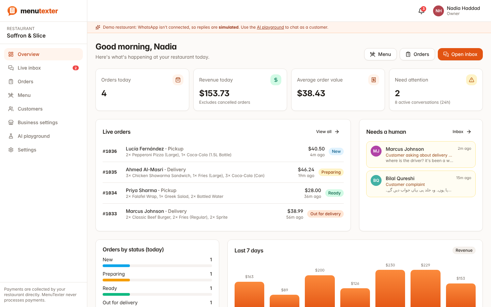
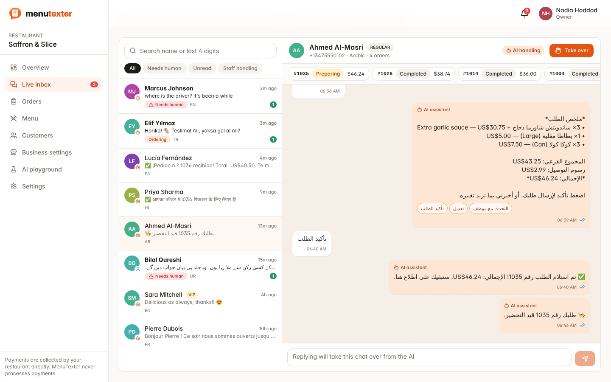
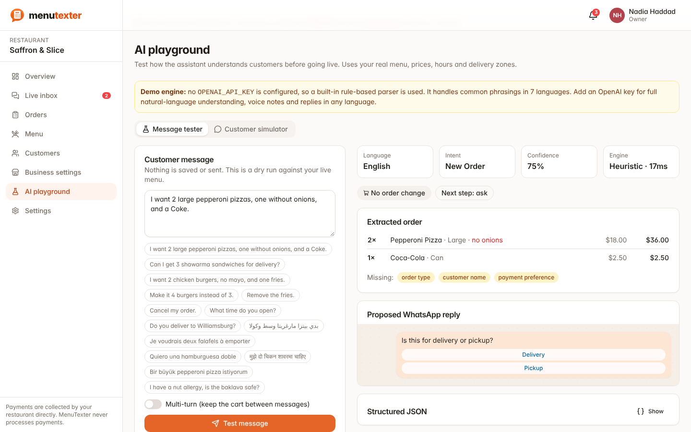

<p align="center"></p>

# MenuTexter

**An AI WhatsApp ordering assistant for local restaurants.** Customers order by text or voice note on WhatsApp, in their own language. MenuTexter understands them, checks everything against the restaurant's real menu, confirms the order, and drops it into a live dashboard for staff.

- 🚫 **No customer website.** The whole customer experience happens inside WhatsApp.
- 🚫 **No online payments.** The restaurant collects payment itself. MenuTexter only records a *preference* (cash, card on delivery, and so on) and never asks for card details or sends payment links.

| Overview | Live inbox (Arabic voice-note order) | AI playground |
|---|---|---|
|  |  |  |

---

## Features

| Area | What you get |
|---|---|
| WhatsApp | Official Meta Cloud API, a per-restaurant webhook with HMAC signature verification, idempotent processing, retries with backoff, sent/delivered/read/failed tracking, interactive buttons and location requests |
| AI ordering | Text **and voice notes** (Whisper), automatic language detection, replies in the customer's language, menu-aware extraction, follow-up questions, an order summary before confirmation, modify/cancel while editable, "Talk to a human" at any time |
| Safety | The model never writes prices: everything is validated and recomputed from the database. Sold-out and unknown items are rejected. Hours, zones, fees and minimums are enforced by code. Prompt-injection hardening, escalation rules and an abuse rate limit |
| Dashboard | Overview and analytics, a WhatsApp-style live inbox (takeover, manual replies, AI suggestions, transcripts), orders (filters, one-click status, assign, print/download ticket, timeline), menu manager (variants, add-ons, sold out, translations, photos), customers, business settings, team and roles, audit log |
| AI playground | Paste a message and see the detected language, intent, extracted order, missing info, proposed reply, and whether it would create, modify or cancel an order. A **customer simulator** runs full end-to-end orders without WhatsApp |
| Languages | Built-in templates for English, Arabic, French, Spanish, Hindi, Urdu and Turkish. Any other language works through the LLM (labels are machine-translated once and cached) |
| Multi-tenant | Every row is scoped by `restaurantId` server-side. Roles are Owner, Manager and Staff |

## Tech stack

Next.js 15 (App Router, TypeScript) · Tailwind CSS + shadcn/ui-style components (Radix) · PostgreSQL + Prisma 6 · OpenAI (structured outputs + Whisper) · Meta WhatsApp Cloud API · Upstash QStash (jobs) + Upstash Redis (rate limits) · Supabase Storage (voice notes and images) · Resend (optional email) · Vercel.

Every external service except Postgres is **optional in development**. Without it, the app falls back to a local equivalent: in-process jobs, an in-memory rate limiter, local-disk storage, and a rule-based AI engine.

---

## Quick start (local)

Requirements: Node 20.9+ (22 recommended) and PostgreSQL 14+.

```bash
npm install
```

```bash
cp .env.example .env
```

Generate the two 32-byte keys and paste them into `.env` as `ENCRYPTION_KEY` and `HASH_KEY`:

```bash
node -e "console.log(require('crypto').randomBytes(32).toString('base64'))"
```

Create the schema and load the demo restaurant:

```bash
npx prisma migrate deploy
```

```bash
npm run db:seed
```

```bash
npm run dev
```

Open http://localhost:3000 and click **Try the demo**, or sign in with `demo@menutexter.app` / `demo-password-2026`. The seed also creates `manager@menutexter.app` and `kitchen@menutexter.app` (same password) so you can see each role.

The demo restaurant, **Saffron & Slice**, has a 22-item multilingual menu, delivery zones, 8 customers writing in 7 languages, conversations (including a voice-note transcript and a complaint escalated to staff), and a week of orders for the analytics.

> **No OpenAI key?** Everything still works using the built-in rule-based engine, which covers common phrasings in all 7 languages. Add `OPENAI_API_KEY` for full natural-language understanding, voice-note transcription and replies in any language.

### Try a full order without WhatsApp

Go to **AI playground → Customer simulator** and type, for example, `2 large pepperoni pizzas and a coke for pickup`. Tap the reply buttons as you would on WhatsApp. The confirmed order appears in **Orders** and the conversation in the **Inbox**, both marked *simulated*.

### Scripts

| Command | What it does |
|---|---|
| `npm run dev` / `build` / `start` | Next.js |
| `npm test` | Unit tests (AI flow, validation, hours, zones, languages, webhook signature and parsing) |
| `npm run typecheck` / `lint` | TypeScript / ESLint |
| `npm run db:migrate` | Create a new migration in development |
| `npm run db:deploy` | Apply migrations manually (the production build already does this) |
| `npm run db:seed` | Reset and reseed the demo restaurant (other restaurants are untouched) |

---

## Deploying (Vercel + Neon/Supabase + Upstash)

> **Use Vercel, not Cloudflare.** This app needs a Node.js server runtime (Prisma, encryption, file uploads). Cloudflare Pages/Workers can't run it without porting it to the Workers runtime.

1. **Database.** Create a Postgres database (Neon, Supabase or Railway).
2. **Vercel.** Import the GitHub repo. The defaults are fine (framework: Next.js; build command: `npm run build`). Add the environment variables:
   - **Required:** `DATABASE_URL` (on Neon, the pooled connection string), `ENCRYPTION_KEY`, `HASH_KEY` (generate each with `node -e "console.log(require('crypto').randomBytes(32).toString('base64'))"`).
   - **Recommended:** `DIRECT_URL` (the non-pooled connection string, used for migrations) and `OPENAI_API_KEY`. Set `DEMO_MODE=false` unless you want the public demo button.
   - `APP_URL` is optional on Vercel; it defaults to your production domain.
3. **Deploy.** The build (`scripts/build.mjs`) creates and updates the database tables automatically. **It never fails because of configuration.** If something is missing or wrong, the site shows a **Setup needed** page that says exactly what to fix. Change the variable, then use Deployments → ⋯ → Redeploy.
4. **Demo data (optional).** Run `npm run db:seed` with `DATABASE_URL` pointing at production if you want the demo restaurant.
5. **Queue (strongly recommended).** In Upstash, create QStash and set `QSTASH_TOKEN`, `QSTASH_CURRENT_SIGNING_KEY` and `QSTASH_NEXT_SIGNING_KEY`. QStash calls `POST {APP_URL}/api/jobs` with signed requests and retries failures. Without it, jobs run after the response inside the same serverless invocation, which is fine at low volume but has no retries.
6. **Rate limiting.** Create an Upstash Redis database and set `UPSTASH_REDIS_REST_URL` and `UPSTASH_REDIS_REST_TOKEN`.
7. **Storage and email.** In Supabase Storage, create a **private** bucket `voice-notes` and a **public** bucket `public-media`, then set `SUPABASE_URL` and `SUPABASE_SERVICE_ROLE_KEY`. Local-disk storage does **not** persist on Vercel. For email notifications (optional), set `RESEND_API_KEY` and `EMAIL_FROM` with a verified domain.
8. **WhatsApp.** Follow [docs/WHATSAPP_SETUP.md](docs/WHATSAPP_SETUP.md) for each restaurant.

The webhook and job routes run on the Node.js runtime. `/api/jobs` sets `maxDuration = 120`; on Vercel Hobby the cap is lower, so use a Pro plan for long voice-note transcriptions.

---

## Architecture

```
WhatsApp ──▶ Meta Cloud API ──▶ POST /api/webhooks/whatsapp/{webhookKey}
                                   verify X-Hub-Signature-256 → store WebhookEvent (unique id) → enqueue
                                                    │
                         QStash ──▶ POST /api/jobs (signed)
                                                    │
     voice note? download → Supabase Storage → Whisper transcript
                                                    │
     AI pipeline:  extract (LLM, JSON schema) → validate (code) → decide (code) → compose reply (LLM)
                                                    │
     Postgres: conversation state, cart, orders, audit ──▶ dashboard (polls /api/live, refreshes)
```

**Why the AI can't invent anything.** The LLM's only job is to *understand* (structured extraction) and to *phrase* replies. Validation (`src/server/ai/validate.ts`) maps every item to a real, available menu item, variant and add-on, and recomputes all prices. The deterministic flow (`src/server/ai/flow.ts`) decides what to ask next, checks hours, delivery zones, minimums and scheduled times, and renders the order summary itself. The composer gets only those facts and is told never to mention prices that aren't in them. Tapped buttons bypass the LLM entirely.

See [docs/IMPLEMENTATION_PLAN.md](docs/IMPLEMENTATION_PLAN.md) for the full design and the product decisions.

### Project structure

```
prisma/                 schema, migrations, demo seed
src/app/                pages (dashboard, onboarding, auth, print) and api/ route handlers
src/components/         ui/ (shadcn-style kit), dashboard/, settings/ (shared forms), brand
src/lib/                client-safe code: schemas (zod), permissions, constants, api client
src/server/
  ai/                   types, extract, validate, flow, compose, i18n, heuristic engine, hours, zones, pipeline
  whatsapp/             Cloud API client (retries), signature, payload parsing, ingest
  services/             inbound processing, orders, messaging, notifications, menu, queries (read models)
  auth/                 sessions, passwords
  crypto, db, env, http, queue, ratelimit, storage, audit, live
```

---

## Security

- **Webhooks:** `X-Hub-Signature-256` is HMAC-verified against each restaurant's own app secret (constant-time compare) before anything is parsed. Each restaurant has an unguessable webhook path and its own verify token. Payloads are size-limited.
- **Idempotency:** each Meta message or status gets a unique `WebhookEvent.externalId`, and `Message.waMessageId` is unique, so retries and replays are no-ops. A per-conversation lease serialises processing so concurrent messages can't corrupt the cart.
- **Secrets at rest:** WhatsApp access tokens, app secrets and the owner's alert number are AES-256-GCM encrypted. Customer phone numbers are encrypted, with an HMAC hash used for lookups. Secrets are never returned to the browser; the UI only shows "saved".
- **Auth:** bcrypt (cost 12) passwords and random 256-bit session tokens stored hashed. Cookies are `HttpOnly`, `Secure` in production and `SameSite=Lax`. Password changes revoke other sessions, deactivating a user revokes all of theirs, and login timing doesn't leak which emails exist.
- **Tenant isolation:** the restaurant id always comes from the session, never from the request. Every query filters on it, and cross-tenant reads return 404. Role permissions are enforced server-side (`src/lib/permissions.ts`).
- **Abuse protection:** rate limits on login, signup, uploads, the playground, staff replies, the webhook (per IP) and AI processing per customer. Customers can be blocked. Uploads are type-checked by magic bytes.
- **Audit log:** order creation, modification, status and assignment changes, menu, settings and team changes, WhatsApp credential changes, logins and AI escalations.
- **Troubleshooting data:** raw inbound payloads, transcripts, the AI's extraction and decision, and outbound requests are stored per message. In the inbox, tap the "AI" chip on a message to see them.
- **Headers:** HSTS, `nosniff`, `X-Frame-Options: DENY` and a strict referrer policy are set in `next.config.ts`.

---

## What remains manual (and why)

These steps need a human with access to Meta and your business documents, so they can't be automated:

1. **Meta Business verification:** submit business documents in Meta Business Manager. Without it, you're limited to a test number and low messaging limits.
2. **WhatsApp phone number:** add and verify a number in WhatsApp Manager (by SMS or voice). It can't already be registered on the consumer WhatsApp app.
3. **Permanent access token:** create a System User in Business Settings, give it the `whatsapp_business_messaging` and `whatsapp_business_management` permissions, assign the WhatsApp account, and generate a non-expiring token.
4. **Webhook configuration:** paste the callback URL and verify token shown in MenuTexter into your Meta app, then subscribe to the `messages` field. It needs a public HTTPS URL.
5. **Message templates (optional):** WhatsApp only allows free-form messages within **24 hours** of the customer's last message. Status updates sent later, or staff alerts to a phone that hasn't written recently, need Meta-approved templates. MenuTexter sends free-form messages and shows a clear error in the inbox when the window has closed.
6. **Payment processing:** intentionally out of scope. The restaurant handles it in person.

## Known limitations and next steps

- The offline rule-based engine is a fallback. For example, it applies "one without onions" to all matching items, where the LLM splits the lines correctly. Use OpenAI in production.
- The dashboard refreshes by polling every 4 seconds, which works on any host. A Pusher or Supabase Realtime transport can replace `LiveProvider` without changing any pages.
- Template messages for outside the 24-hour window aren't built yet. The extension point is `sendToCustomer`.
- A user belongs to one restaurant. Multi-location groups would need a membership table.
